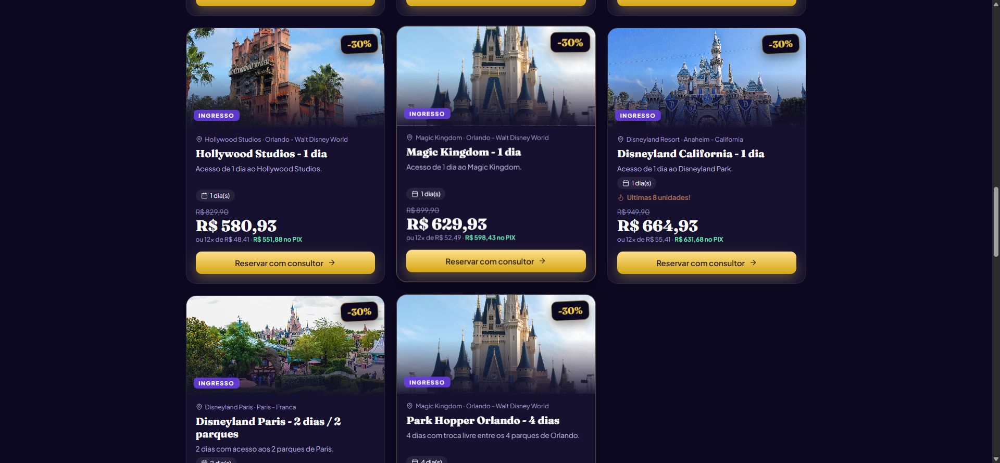

<p align="center">
  
</p>

<h1 align="center">✨ MagicPass Viagens</h1>
<p align="center"><b>Projeto Integrador · SENAC 2026</b></p>

<p align="center">
  
  
  
  
  
</p>

Sistema de **venda de ingressos e pacotes de viagem para os parques Disney**, com campanha **Black Friday**.
Back end em **Spring Boot 3.5 (Java 17+)** e front end em **Angular 21**, seguindo POO e MVC.

---

## 📸 Preview

<p align="center">
  
  <br><i>Área do consultor — login restrito</i>
</p>

<p align="center">
  
  <br><i>Vitrine pública — personagens e destinos</i>
</p>

---

## 🚀 Como rodar

### Opção A — um único arquivo (recomendado para a máquina do professor)
Requisito: Java 17 ou mais novo.
```bash
java -jar magicpass.jar
```
Abra **http://localhost:8080**. O banco H2 é criado sozinho na pasta `data/` e já vem com dados de exemplo.

> 💡 Se a porta 8080 já estiver em uso por outro serviço, rode com uma porta alternativa:
> ```bash
> java -jar magicpass.jar --server.port=8081
> ```

(Para gerar o `magicpass.jar` e o `.zip`: `powershell -ExecutionPolicy Bypass -File empacotar.ps1`)

### Opção B — desenvolvimento (2 terminais)
```bash
cd backend   &&  mvn spring-boot:run          # API em http://localhost:8080
cd frontend  &&  npm install && npx ng serve  # tela em http://localhost:4200
```

### 🔐 Logins iniciais
| Perfil | Login | Senha |
|---|---|---|
| Administrador | `admin` | `admin123` |
| Vendedor | `vendedor` | `vendedor123` |

Novos usuários são cadastrados pelo administrador na tela **Usuários** (as senhas são gravadas com hash BCrypt).

---

## ☁️ Deploy (produção)

Arquitetura separada, igual aos outros projetos: **Angular no Vercel** + **Spring Boot no Render**.

### Backend → Render
1. Crie um novo **Web Service** no [Render](https://render.com), conectado a este repositório.
2. O arquivo `render.yaml` já define root `backend/`, build (`mvn clean package`) e start (`java -jar target/magicpass-1.0.0.jar --server.port=$PORT`).
3. Após o primeiro deploy, copie a URL pública (ex.: `https://magicpass-backend.onrender.com`).

### Frontend → Vercel
1. Importe este repositório no [Vercel](https://vercel.com/new), apontando o **Root Directory** para `frontend/`.
2. Antes do deploy, atualize `frontend/src/environments/environment.prod.ts` com a URL real do backend no Render (`apiUrl: 'https://SEU-BACKEND.onrender.com/api'`).
3. O `vercel.json` já configura build (`npm run build`), output (`dist/frontend/browser`) e rewrites de SPA.
4. CORS no backend (`WebConfig.java`) já libera qualquer subdomínio `*.vercel.app`.

> Plano free do Render "dorme" após inatividade — a primeira requisição do dia pode demorar ~30s para acordar o serviço.

---

## 👥 Integrantes

| Nome |
|---|
| Matheus Goulart |
| Yago |
| Erik Davi |
| Murilo Luiz |
| Victor Harger |

**Professor:** Marcos Monteiro · **Apresentação:** 17/11/2026 e 24/11/2026

---

## ✅ Requisitos do PI atendidos
| Requisito | Onde |
|---|---|
| Spring Boot + Angular | `backend/` e `frontend/` |
| CRUD completo (cadastrar, ler, alterar, apagar) | Clientes, Parceiros, Parques, Ingressos/Pacotes, Promoções, Usuários e Vendas |
| POO + MVC | Model (`model/`, herança de `EntidadeBase`), Controller (`CrudController` genérico), Service (`CrudService` com Template Method) e View (Angular) |
| Login e senha cadastrados pelo administrador | Tela Usuários (só ADMIN), token de sessão, perfis ADMIN/VENDEDOR |
| CPF, CNPJ, RG e IE validados pelos dígitos verificadores | `validation/DocumentoValidator.java` (back) e `core/validadores.ts` (front). CNPJ aceita o novo formato alfanumérico; IE para SP, RJ, PR e SC (ou ISENTO) |

## 🛡️ Regras que evitam erros (ex.: "-1")
- Id nulo, zero, negativo ou inexistente → **404 com mensagem clara**, nunca exceção crua.
- Preço, estoque, dias, quantidade e desconto negativos são recusados (back e front).
- O estoque **nunca fica negativo**: venda, alteração, cancelamento e exclusão ajustam o estoque numa transação (tudo ou nada).
- Não deixa apagar registro em uso (cliente com venda, produto vendido, parque com produtos) → 409 com orientação.
- Login duplicado, CPF/CNPJ duplicado e cupom duplicado são bloqueados.
- O último administrador ativo não pode ser excluído nem desativado.
- Todo erro volta como JSON `{status, mensagem, campos}` e aparece no formulário, ao lado do campo.

## 🛍️ Black Friday (motor de preços)
- Campanha automática por categoria (Ingressos 30% / Pacotes 40%).
- **Família/grupo:** a partir de 4 itens, +5%.
- **Cupom** `BLACKMAGIC`: +10%.
- **PIX:** +5% no total; cartão em até 12x sem juros.
- Desconto máximo de 70% por item. A vitrine pública `/black-friday` tem contagem regressiva, cupom que copia com um clique e um simulador para a viagem da família.

## 🎨 Visual e animações
- Fotos reais dos 6 parques e dos personagens nos desfiles (Mickey, Cinderela, Rapunzel, Dumbo, Ariel), todas do Wikimedia Commons com licença livre. Os créditos ficam em `frontend/public/img/CREDITOS.md` e no rodapé da vitrine.
- Ícones SVG próprios no lugar dos emojis; o logo é uma estrela dourada animada.
- Animações: zoom lento nas fotos de fundo, brilhos dourados subindo, contagem regressiva pulsando, cards que aparecem em cascata ao rolar a página, faixa de personagens rolando sem parar, números do painel contando até o valor e transição suave entre as telas.
- Quem ativa "reduzir movimento" no sistema operacional vê tudo sem animação.

## 🧪 Testes automatizados
```bash
cd backend && mvn test
```
São 12 testes: validadores e fluxo real da API, cobrindo CRUD, ids -1/0, negativos, estoque, permissões e Black Friday.

## 🗺️ Próximos passos (escalar para venda real)
- Tornar-se revendedor autorizado ou integrar com uma operadora/consolidadora credenciada (a venda de ingressos oficiais exige esse vínculo).
- Gateway de pagamento (PIX/cartão) e emissão de voucher.
- Carrinho público para o cliente final, migração para MySQL/PostgreSQL (perfil `mysql` já incluído) e JWT.

---

<p align="center"><i>Projeto acadêmico. Disney e as marcas relacionadas pertencem à The Walt Disney Company. Os preços são ilustrativos.</i></p>
